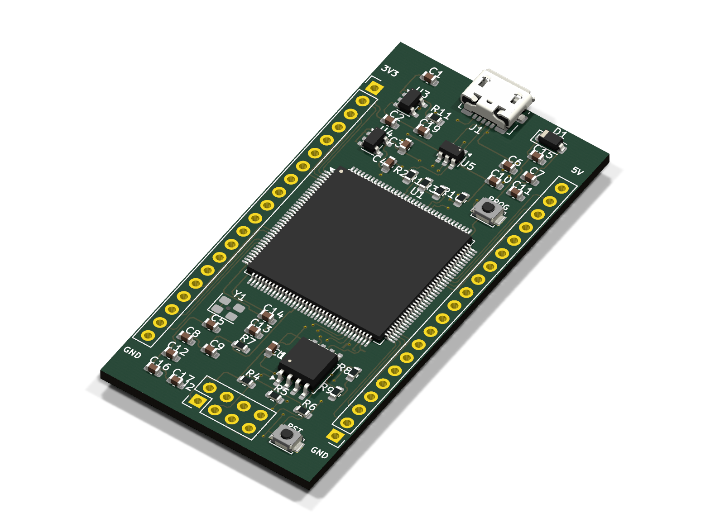
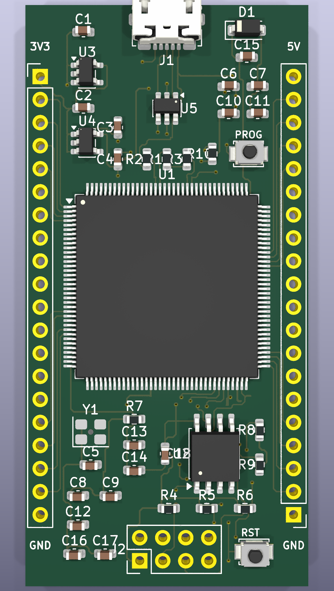
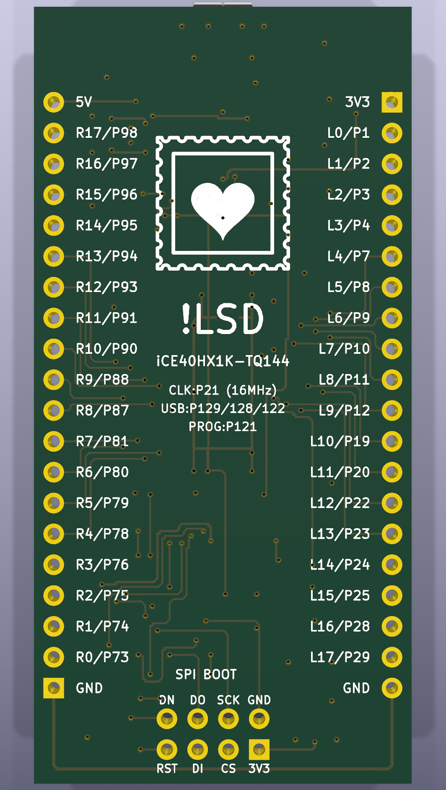

# LSD — Lattice iCE40HX1K-TQ144 USB Breadboard FPGA Core

> [!WARNING]
> **Work in Progress (WIP):** This hardware design is currently a work in progress and has not yet been fabricated or electrically validated on physical silicon. Review the schematic, BOM, and Gerbers carefully before ordering PCBs.

<p align="center">
  
</p>

**LSD** (*"Warning: Highly Addictive!"*) is a minimal, breadboardable 2-layer **Lattice iCE40HX1K-TQ144** (1,280 LUTs) FPGA core board designed in **KiCad 10**. It is programmable directly over **USB Micro-B** with **no FTDI bridge chip** by running an open-source RTL USB DFU bootloader (`no2bootloader` / `no2usb`) directly inside the FPGA fabric.

| Top View | Bottom View (Pinout & Logo) |
| :---: | :---: |
|  |  |

---

## Hardware Specifications

* **FPGA:** Lattice `iCE40HX1K-TQ144` (1,280 4-LUTs, 64 kbit EBR, 1× `SB_PLL40_CORE`, 144-pin 0.5 mm TQFP)
* **Form Factor:** `31.2 mm × 64.0 mm` 2-layer FR-4 PCB (1.6 mm), solid `B.Cu` ground plane, 45°-mitered routing
* **Breadboard Headers:** Two 1×20 2.54 mm through-hole rows (`J3` left, `J4` right) spaced **`27.94 mm` (1.100″ / 11 × 2.54 mm)** apart center-to-center — **36× 3.3V GPIOs**, `+3V3` (top-left), `+5V` VBUS (top-right), and `GND` (bottom-left & bottom-right). Headers are unpopulated by default for user soldering.
* **FTDI-less USB Micro-B (`no2bootloader` ready):** Top-edge horizontal `Molex 47346-0001` (`J1`) → `USBLC6-2SC6` ESD protection (`U5`) → `27 Ω` 1% series damping resistors (`R1`, `R2`) + software-controlled `1.5 kΩ` `D+` pull-up (`R3`, on connector side of `R1`) wired directly to Bank 0 pins `129` (`USB_DN`), `128` (`USB_DP`), and `122` (`USB_PU`).
* **Clock:** `16 MHz` 3.3V CMOS oscillator (`Y1`, Abracon ASE 3.2×2.5 mm) wired to `GBIN6` (Pin `21`), multiplied to an exact `48.000 MHz` via `SB_PLL40_PAD` / `SB_PLL40_CORE` (`DIVR=0`, `DIVF=47`, `DIVQ=4`, `FILTER_RANGE=1`) for Full-Speed USB.
* **SPI Flash:** `W25Q16JVSS` (16 Mbit / 2 MB SOIC-8, `U2`) wired in Master SPI multiboot mode (`Pin 67 SDO → Flash DO`, `Pin 68 SDI → Flash DI`, `Pin 70 SCK`, `Pin 71 SS`) with `10 kΩ` pull-ups on `FLASH_CS_N`, `CRESET_B`, `CDONE`, `~WP`, and `~HOLD`.
* **Push Buttons (Omron `B3U-1000P`):**
  * **`RST` (`SW1`):** Pulls `CRESET_B` (Pin `66`) low to reset and reboot the FPGA from SPI Flash.
  * **`PROG` (`SW2`):** Active-low input on Pin `121` (`PROG_BTN_N`, `10 kΩ` pull-up `R10`). Hold **`PROG`** and tap **`RST`** to keep the FPGA in USB DFU bootloader mode.
* **Power Supply:** Cascaded low-noise LDOs from USB 5V: `AP2112K-3.3` (`U3`, 3.3V I/O & Flash) → `AP2112K-1.2` (`U4`, 1.2V Core + RC-filtered `VCCPLL`), plus `1N4148W` drop diode (`D1`) for `VPP_2V5` per the Lattice iCE40 Hardware Checklist.
* **One-Time SPI Bootstrap Header (`J2`):** Unpopulated 2×4 2.54 mm header at the bottom edge (`3V3`, `GND`, `CS`, `SCK`, `DI`, `DO`, `RST`, `DN`) for flashing the bootloader once onto a blank SPI Flash.

---

## power stuff to fix before fab

- The schematic now uses a separate `GNDPLL` net for U1 pin 35 and the return sides of C13/C14. The PLL ground is internally referenced inside the FPGA, so don't connect this net to the board GND plane. The flag on GNDPLL is just for ERC, not an external power connection.
- PCB still needs updating from the schematic: remove the old GND connections/vias for those three pads, route the dedicated PLL return, and keep the 100nF cap close to U1. Route VCCPLL from pin 36 to C14, then C13, then R7. Refill zones and check that neither PLL return nor its vias touch the system GND plane.
- The 1.2V LDO currently gets its input from 3.3V, which doesn't guarantee the recommended startup order. Need a sequenced supply design with VCC/VCCPLL reaching at least 0.5V before SPI_VCC, and SPI_VCC before VPP_2V5. Check regulator EN thresholds, PLL RC ramp, thermal dissipation and worst-case loads; just swapping the regulator inputs isn't enough.

Reference: [Lattice FPGA-TN-02006-2.4](https://www.latticesemi.com/-/media/LatticeSemi/Documents/ApplicationNotes/IK/FPGA-TN-02006-2-4-iCE40-Hardware-Checklist.ashx?document_id=47779), fig 2.1 and sections 2.2/2.3.

**Don't fab from this branch yet.** PCB, Gerbers, and renders are still rev 2.3. The results below are from the original design, not from this schematic change. Rerun ERC/DRC and regenerate all fab outputs after routing and sequencing are done.

## Verification (KiCad `10.0.3` CLI)

* **Schematic ERC (`kicad-cli sch erc`):** `0` errors, `0` warnings
* **2-Layer PCB DRC (`kicad-cli pcb drc --refill-zones`):** `0` errors, `0` unconnected items

---

## Programming Guide (`no2bootloader` USB DFU)

Because `no2bootloader` / `no2usb` is a compact pure-Verilog USB Full-Speed DFU bootloader (~500–800 LUTs), it fits comfortably inside the 1,280-LUT `iCE40HX1K` and works with standard `dfu-util` (no FTDI chip or custom host drivers required).

### Prerequisites
Install the open-source IceStorm FPGA toolchain + `dfu-util` (e.g., via Homebrew on macOS or [OSS CAD Suite](https://github.com/YosysHQ/oss-cad-suite-build/releases)):
```bash
brew install yosys nextpnr-ice40 icestorm dfu-util
```

### Stage 1: One-Time Bootloader Bring-Up (via `J2`)
A blank `W25Q16JVSS` flash has no bitstream yet, so flash `no2bootloader` **once**:

1. **Build `no2bootloader` for `hx1k` (`tq144`)** using the pinout in [pins.pcf](pins.pcf):
   * `CLK_16M` → Pin `21` (`GBIN6`; 16 MHz → 48.000 MHz exact via `SB_PLL40_PAD`/`SB_PLL40_CORE` with `DIVR=0`, `DIVF=47`, `DIVQ=4`, `FILTER_RANGE=1`)
   * `USB_DP` → Pin `128`, `USB_DN` → Pin `129` (`27 Ω` series), `USB_PU` → Pin `122` (`1.5 kΩ` software pull-up)
   * `PROG_BTN_N` → Pin `121` (active-low, `10 kΩ` pull-up)
   * `FLASH_DO` → `67`, `FLASH_DI` → `68`, `FLASH_SCK` → `70`, `FLASH_CS_N` → `71`
2. **Pack the multiboot image** with `icemulti` (Slot 0 = bootloader, Slot 1 = user bitstream):
   ```bash
   icemulti -v -p0 -a16 -o flash_init.bin boot.bin
   ```
3. **Wire a 3.3V SPI programmer** (Raspberry Pi, RP2040/Pico, FT232H, or 3.3V CH341A) to `J2` (`3V3`, `GND`, `CS`, `SCK`, `DI`, `DO`) and hold **`RST` (`CRESET_B`) LOW** to tri-state the FPGA SPI pins.
4. **Flash `flash_init.bin` to `W25Q16JVSS` at offset `0x000000`:**
   ```bash
   flashrom -p <your_3v3_programmer> -w flash_init.bin
   ```
5. **Release `RST` and disconnect `J2`.** All future programming happens over USB Micro-B.

### Stage 2: Everyday Programming Over USB Micro-B
1. **Synthesize and pack your Verilog design:**
   ```bash
   yosys -p "synth_ice40 -top top -json build.json" top.v
   nextpnr-ice40 --hx1k --package tq144 --pcf pins.pcf --json build.json --asc build.asc
   icepack build.asc build.bin
   ```
2. **Enter USB DFU mode:** Plug in USB Micro-B, **hold `PROG`**, **tap `RST`**, then release `PROG`. Verify with `dfu-util -l`.
3. **Flash over USB:**
   ```bash
   dfu-util -a 0 -D build.bin -R
   ```
   The `-R` flag triggers `SB_WARMBOOT` to immediately reboot into your design. Tap **`RST`** anytime to reboot.

---

## Interactive 3D Viewer & Project Files

To inspect the photorealistic PBR 3D board in your browser:
```bash
python3 -m http.server 8000
# Open http://localhost:8000/viewer.html
```

| Path | Description |
| :--- | :--- |
| `ice40hx1k_usb_core.kicad_pro` | KiCad 10 project & 2-layer design rules |
| `ice40hx1k_usb_core.kicad_sch` | Complete schematic (`0` ERC violations) |
| `ice40hx1k_usb_core.kicad_pcb` | Routed `31.2 × 64.0 mm` 2-layer PCB (`0` DRC errors, `0` unconnected) |
| `pins.pcf` | IceStorm / `nextpnr-ice40` pin constraint file matching back silkscreen |
| `fab/gerbers/` | Fabrication-ready 2-layer Gerber X2 + Excellon `.drl` + drill map |
| `fab/bom.csv` | Bill of Materials |
| `fab/lioncircuits/` | LionCircuits-formatted Gerber `.zip`, BOM `.xlsx`/`.csv`, and CPL `.xlsx`/`.csv` |
| `renders/ice40hx1k_usb_core.glb` | Full-detail PBR 3D model (WebGL / Three.js / `<model-viewer>`) |
| `renders/ice40hx1k_usb_core.step` | Mechanical CAD 3D model (Fusion 360 / FreeCAD / SolidWorks) |
| `renders/schematic.pdf` | Printable schematic PDF |
| `renders/logo.{svg,png,jpg}` | LSD square stamp-heart logo assets |
| `viewer.html` | Interactive `<model-viewer>` 3D PCB viewer |

---

## License

Released under the [MIT License](LICENSE).
